

  

<h1 align="center">MARPS · Mars Adaptive Route Planning System</h1>

  <strong>Tell the crew's mission. Get the route that fits it.</strong> 
  A mission-aware route planner for surface excursions on Mars, built on NASA data. 
  NASA Space Apps Challenge 2026 · <em>Interplanetary Survival Guide: Martian Map</em>

  <a href="docs/media/product/mission-to-route.mp4">
    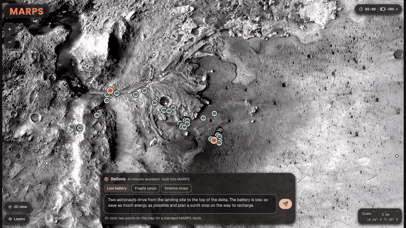
  </a>

  <a href="docs/media/product/demo.mp4"><strong>▶ Watch the full product tour (MP4, 1 min)</strong></a>

---

## The problem

A walk on Mars is not a hike. The crew has a suit with a limited battery, sample tubes that must not be shaken, a daylight window, radiation to dodge and a science plan that only makes sense in certain places.

Route planners we know optimise **geometry**: shortest distance, lowest slope. But the best path depends on **why the crew is going out**. The same two points on the map need a different route for a rushed run with a nearly flat battery, for a careful carry of fragile cargo, or for a geology trip to carbonate-rich outcrops.

## The product

MARPS is a map of Jezero crater, a planner and an assistant in one screen.

1. **You describe the mission** in plain language to **Bellona**, the on-board assistant.
2. **MARPS understands it**: crew, cargo, battery, risk appetite, science targets.
3. **It computes the route** over a stack of NASA map layers, respecting hard safety limits.
4. **Bellona briefs the crew**: why this path, what it saves, where to stop and recharge.
5. **You inspect it** in 2D, in 3D over the real relief, and even from the ground with reconstructions of Perseverance imagery.

> “Two astronauts drive from the landing site to the top of the delta. The battery is low, so save as much energy as possible and plan a sunlit stop on the way to recharge.”

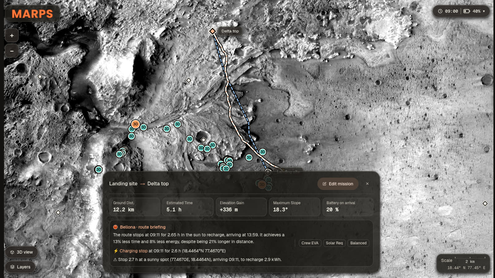

---

## One destination, three missions, three routes

Same origin (Octavia E. Butler landing site), same destination (top of the western delta). Only the mission changes.

| 🔋 Low battery | 🧪 Fragile cargo | 🔬 Science stops |
|---|---|---|
|  | [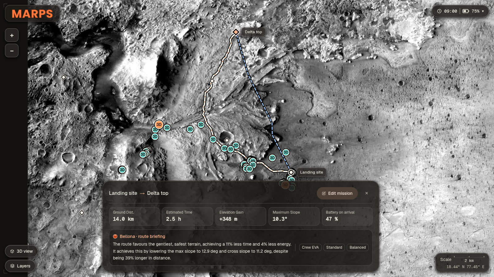](docs/media/product/route-fragile-cargo.jpg) | [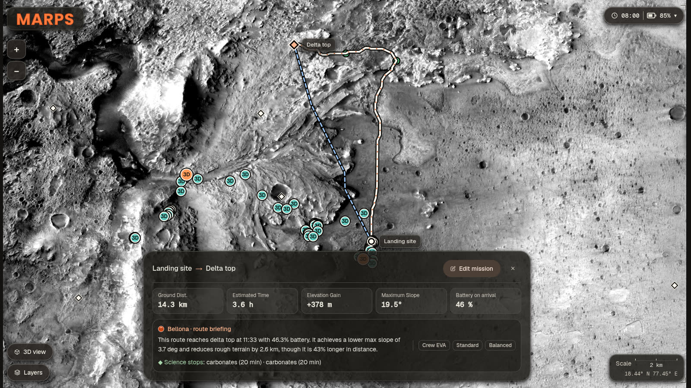](docs/media/product/route-science.jpg) |
| Saves energy and includes a **sunlit stop** where the crew recharges. | Takes the **gentlest, safest terrain** with wide margins around hazards. | Detours through **carbonate and clay-rich terrain** with timed science stops. |
| **12.2 km** · 5.1 h · max slope 18.3° · arrives with 20 % battery | **14.0 km** · 2.5 h · max slope 10.3° · arrives with 47 % battery | **14.3 km** · 3.6 h · two 20-minute science stops |

The dashed blue line on every map is a classic shortest-path A\*. MARPS shows it so the crew can see exactly what the mission context changed, and Bellona states the trade-off: where the route is longer, it says what the extra distance buys.

---

## See the route come to life in 3D

One tap on **3D view** tilts the map into the real Martian relief. The route draws itself across the terrain and the camera can be orbited freely.

  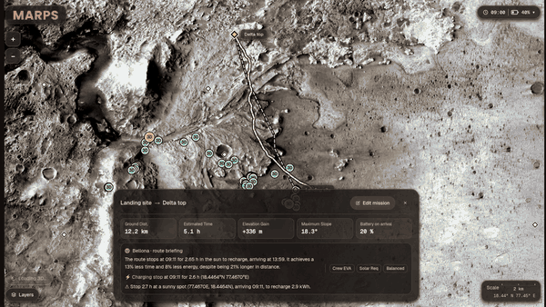

| Orbit around the route | Any data layer draped on the relief |
|---|---|
| [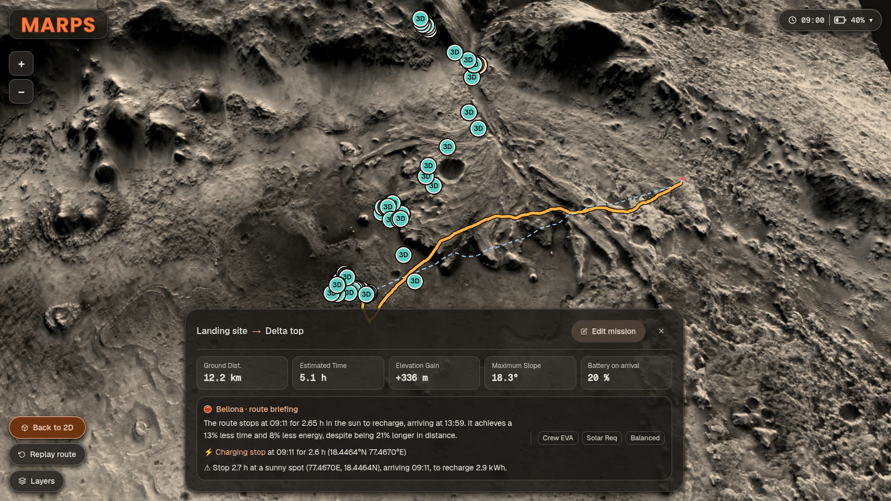](docs/media/product/route-3d-orbit.jpg) | [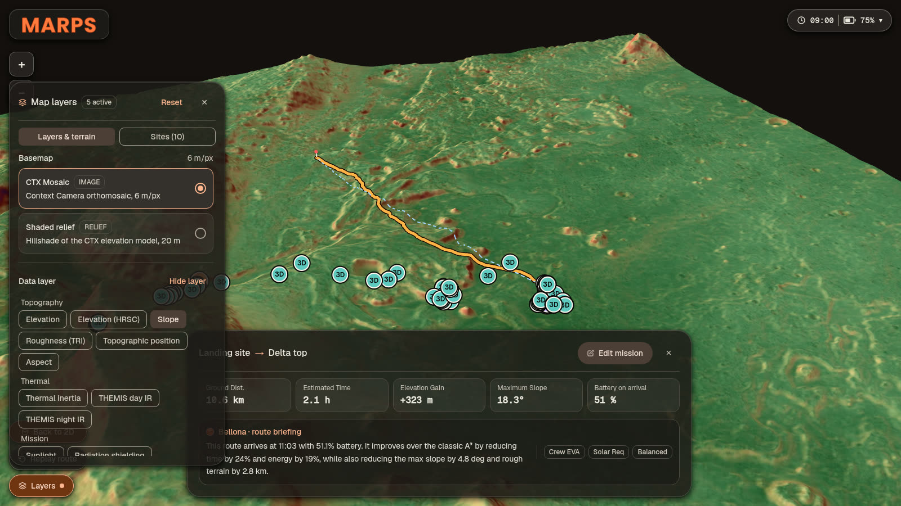](docs/media/product/route-3d-slope.jpg) |

## A map with many layers, not just a picture

Switch layers on and off, in 2D or draped over the 3D relief. Slope, roughness, thermal inertia, sunlight, radiation shielding, geology and mineralogy come from several NASA, ESA and USGS missions and share one 20 m grid, so they can be combined.

  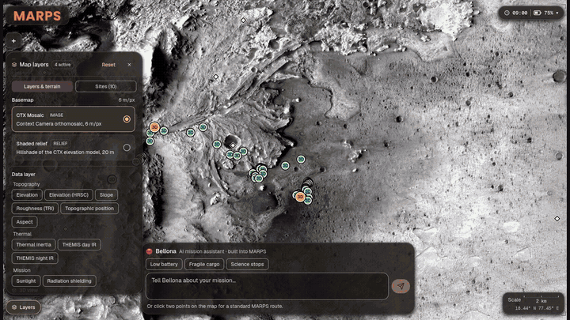

| Slope | Radiation shielding |
|---|---|
| [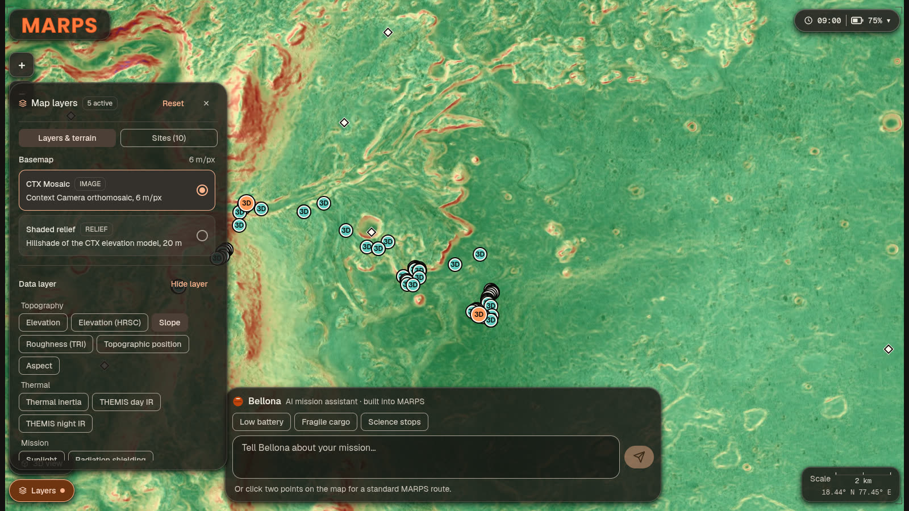](docs/media/product/layers-slope.jpg) | [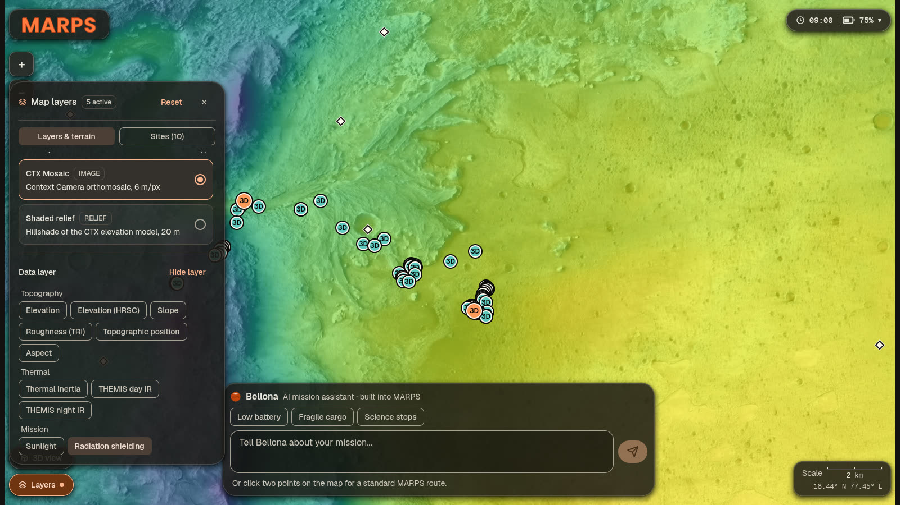](docs/media/product/layers-radiation.jpg) |

## Step off the map and onto the surface

Every **3D marker** is a reconstruction built from real Perseverance imagery. Click one and walk through it in first person, or orbit it, so the crew knows what the ground looks like before they leave.

  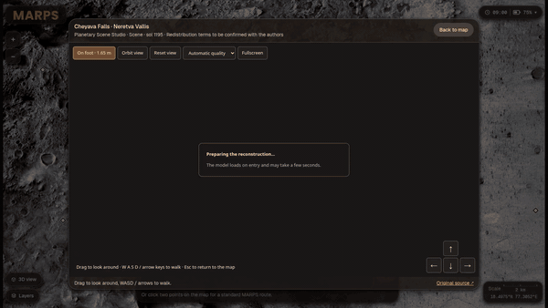

| On foot at Cheyava Falls | Orbit view |
|---|---|
| [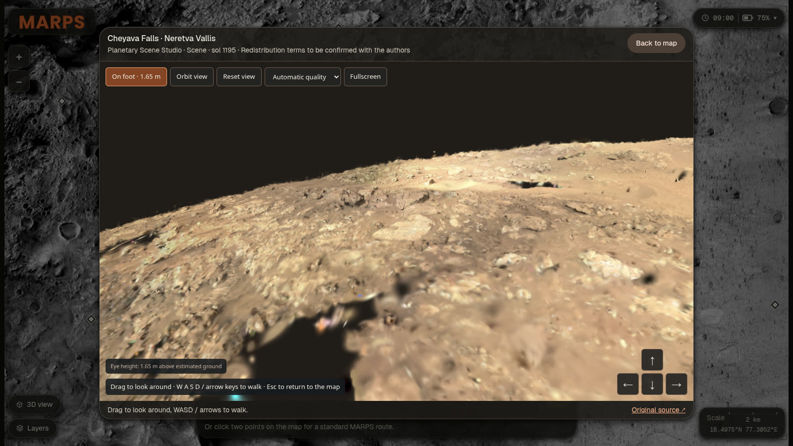](docs/media/product/surface-onfoot.jpg) | [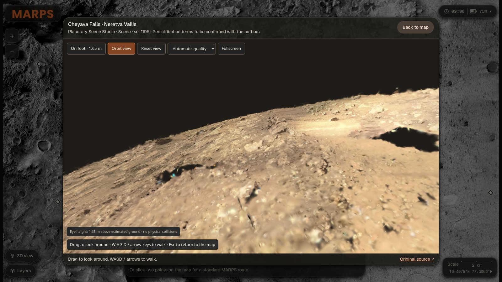](docs/media/product/surface-orbit.jpg) |

## Works on a tablet or phone

The interface adapts to small screens: Bellona folds behind the logo and the route briefing becomes a collapsible card.

  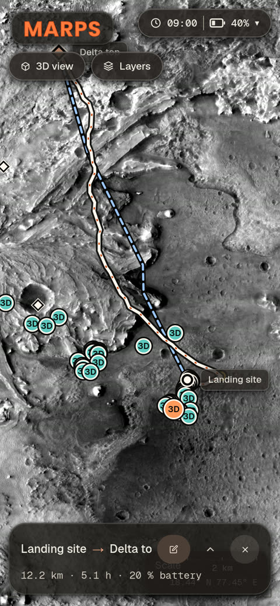

---

## What sets MARPS apart

| | Typical route planner | **MARPS** |
|---|---|---|
| **What decides the route** | Terrain geometry | Terrain **and the purpose of the mission** |
| **How you give the mission** | Menus and sliders | A sentence in natural language |
| **Safety** | A parameter that can be tuned away | **Hard limits that are always enforced**: slope, cross slope, hazard buffers, daylight and battery |
| **Role of AI** | Black box that picks the path | The language model only **sets preferences**. A deterministic planner draws the path, so results are reproducible and explainable |
| **Explanation** | A line on a map | Bellona's briefing, written from **verified planner figures only** |
| **Comparison** | None | Every route is shown against the classic shortest path |
| **Energy and sun** | Ignored | Battery reserve, terrain shadows and **sunlit charging stops** |
| **Connectivity** | Cloud services | Small models that can **run locally**, with no link to Earth |
| **Context** | A top-down map | 2D, 3D relief and **first-person surface reconstructions** |

### Safety comes first

The language model can change what the crew *prefers*, never what is *allowed*. Whatever the model outputs, the planner refuses slopes, cross slopes and hazard margins beyond the limits for the crew and vehicle, and checks the battery reserve and the daylight window.

---

## How it answers the challenge

| The challenge asks for | MARPS |
|---|---|
| A hyperlocal, layered map of one area | 14 layers of Jezero crater on a common 20 m grid |
| At least three NASA data types | Topography (MRO CTX, Mars Express HRSC), thermal (Mars Odyssey THEMIS), spectral (MRO CRISM), geology (USGS) and derived sunlight and radiation exposure |
| Astronaut safety first | Enforced slope, hazard, daylight and battery constraints |
| A route that meets the science goals and avoids obstacles | Science targets in the mission text bend the route through carbonates, clays and more |
| First-person imagery from rovers | 3D reconstructions of Perseverance imagery, walkable from the map |

## Built on public NASA, ESA and USGS data

MRO CTX · Mars Express HRSC · Mars Odyssey THEMIS · MRO CRISM · USGS geologic map SIM 3464 · Mars 2020 Perseverance imagery. Provenance, licences and processing of every layer are in [docs/DATA_SOURCES.md](docs/DATA_SOURCES.md). The use of NASA data does not imply endorsement by NASA.

## Want to know more?

| | |
|---|---|
| [docs/CHALLENGE.md](docs/CHALLENGE.md) | The challenge and how MARPS answers it |
| [docs/CONCEPT.md](docs/CONCEPT.md) | Concept and design principles |
| [docs/TECHNICAL.md](docs/TECHNICAL.md) | Architecture, how it is built and how to run it locally |
| [docs/PLANNER.md](docs/PLANNER.md) | The route cost model |
| [docs/media/product/README.md](docs/media/product/README.md) | How the videos and images above were recorded |

The live demo ([marps-bellona.vercel.app](https://marps-bellona.vercel.app)) is hosted for the event and may be offline afterwards; everything it does is shown above.

## Licence

The original code and documentation of MARPS are released under the [Apache License 2.0](LICENSE). Attribution and third-party terms are in [NOTICE](NOTICE). The licence does not cover third-party material: NASA and USGS data are in the public domain in the United States, other datasets keep their own terms and must be cited, surface reconstructions keep the terms of their authors, and the language models follow the Gemma model terms.
