<p align="center">
  
</p>

# MARPS: Mars Aerial Route Pairing System

**Describe the mission. Find a route. Explore Mars.**

MARPS is a mission-aware route planner for surface excursions on Mars, built for the NASA Space Apps Challenge 2026 challenge **Interplanetary Survival Guide: Martian Map**. Explore Jezero crater, tell **Bellona** what the crew needs, and inspect the resulting route in 2D and 3D.

**[Open the live demo ↗](https://marps-bellona.vercel.app)** · [Visual guide](#from-mission-text-to-route) · [Surface exploration](#step-from-the-map-onto-the-surface) · [Run locally](#quick-start) · [Documentation](#documentation)

[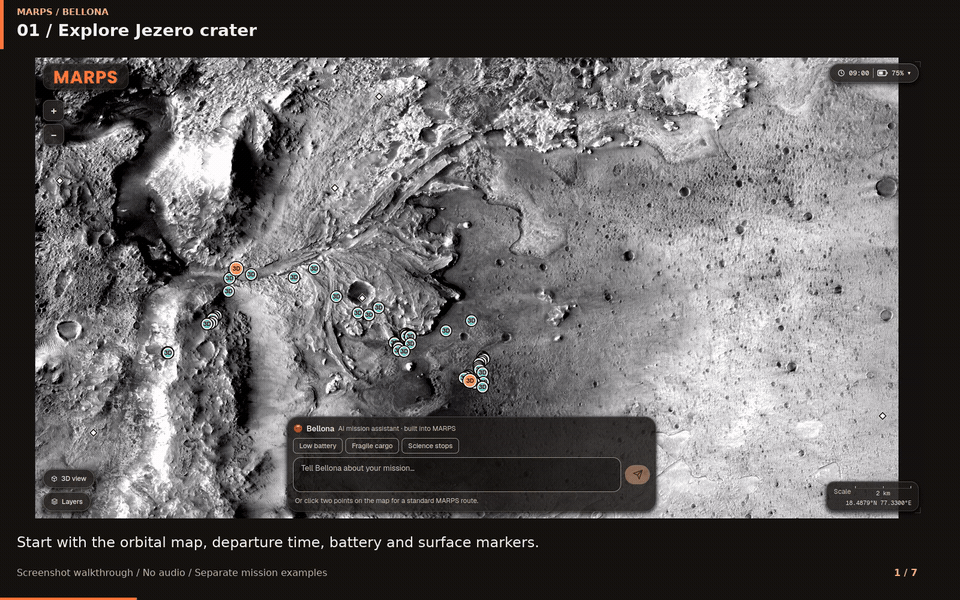](docs/media/mission-walkthrough.mp4?raw=true)

**Watch the walkthroughs:** [Mission planning · 42 s · MP4](docs/media/mission-walkthrough.mp4?raw=true) · [Surface exploration · 20 s · MP4](docs/media/surface-exploration.mp4?raw=true)

*Silent, captioned videos assembled from the application screenshots supplied for this guide. The preview above loops through the mission-planning slides; select it to open the MP4. [Text transcripts and media sources](docs/media/README.md).*

## From mission text to route

Classic planners minimise distance. On Mars the best route also depends on **why the crew goes out**, what they carry, and how much energy and daylight they have. MARPS turns a natural-language mission into planner parameters, computes a route over NASA-derived map layers, and explains the result with Bellona.

### 1. Tell Bellona what the crew needs

Choose **Low battery**, **Fragile cargo** or **Science stops**, or write your own mission. Set the departure time and battery in the top-right telemetry control.

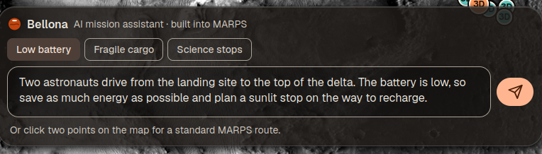

> “Two astronauts drive from the landing site to the top of the delta. The battery is low, so save as much energy as possible and plan a sunlit stop on the way to recharge.”

### 2. Explore the map and request a route

| Explore Jezero | Let MARPS evaluate the mission |
|---|---|
| [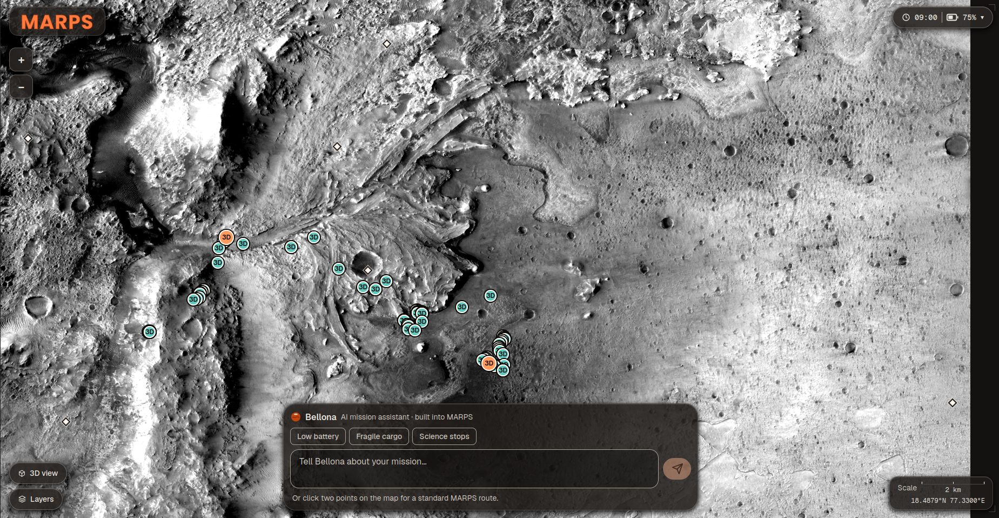](docs/media/screenshots/jezero-map.webp) | [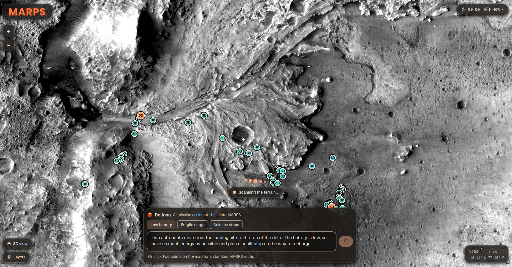](docs/media/screenshots/bellona-scanning.webp) |
| Pan and zoom, inspect the layers, and find surface reconstructions. | Submit the mission. The planner evaluates the terrain and mission constraints. |

### 3. Inspect the route in 2D

You can also **click two points on the map** to request a standard MARPS route. Compare the result with the dashed shortest-path A* baseline.

| Select origin and destination | Compare the resulting paths |
|---|---|
| [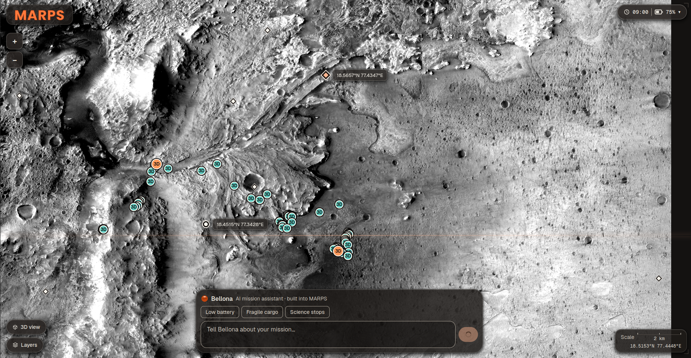](docs/media/screenshots/manual-endpoints.webp) | [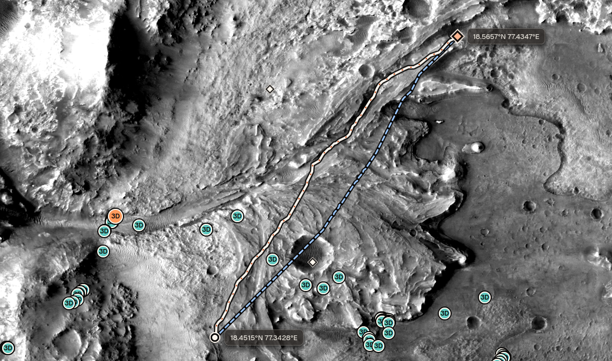](docs/media/screenshots/route-2d.webp) |

### 4. Read Bellona’s briefing

Review **distance, estimated time, elevation gain, maximum slope and battery on arrival**. When the mission requires solar recharging, the report includes the stop location, arrival time and charging duration.

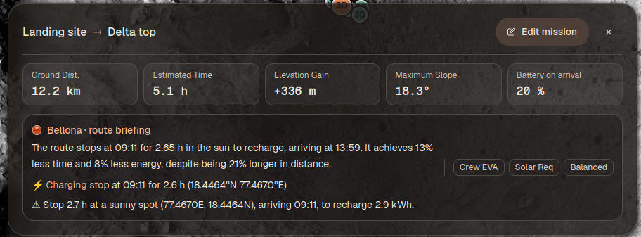

The SLM never plans: the route comes from a deterministic planner and its safety limits are always enforced. Bellona writes its briefing from verified planner figures.

## One destination, different mission priorities

Switch to **3D view** to see how the path crosses the relief. These captures show two separate mission scenarios between the landing site and the delta top, each with its own starting battery state.

| Low battery · solar recharge | Gentle, safer terrain |
|---|---|
| [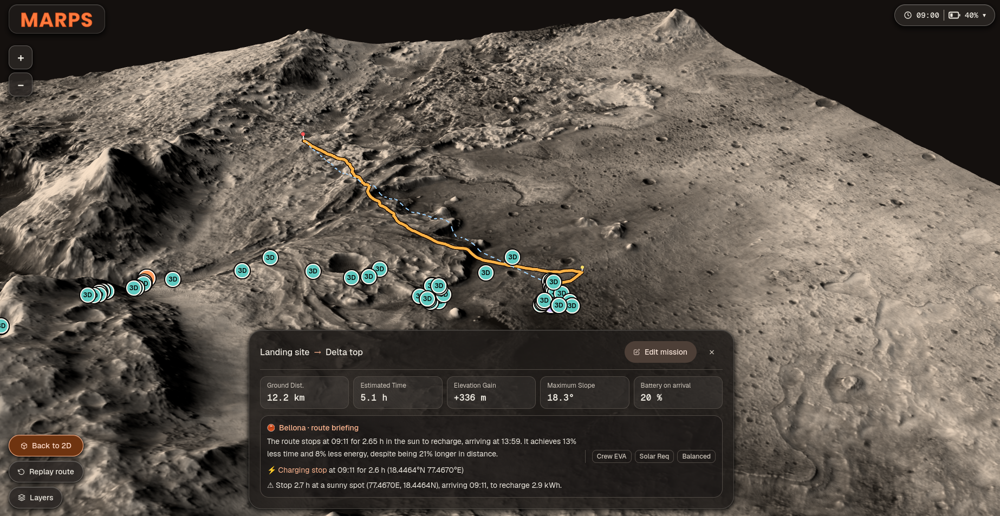](docs/media/screenshots/route-solar-recharge.webp) | [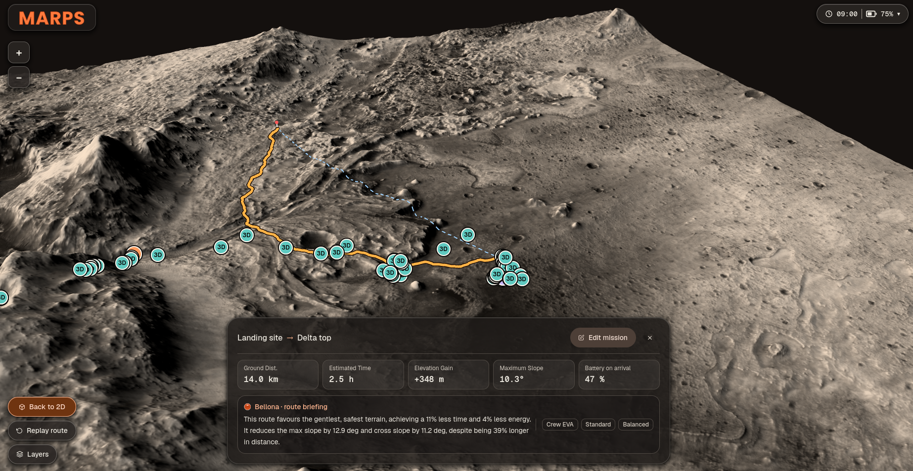](docs/media/screenshots/route-gentle-terrain.webp) |
| Save energy and include a sunlit charging stop. | Favour gentler terrain under the mission’s safety constraints. |

| Figure shown in the screenshots | Solar-recharge scenario | Gentle-terrain scenario |
|---|---|---|
| Starting battery | 40% | 75% |
| Ground distance | 12.2 km | 14.0 km |
| Estimated time | 5.1 h, including the charging stop | 2.5 h |
| Elevation gain | +336 m | +348 m |
| Maximum slope | 18.3° | 10.3° |
| Battery on arrival | 20% | 47% |

### Plan for science, too

Describe science targets such as **carbonates and clays**, then inspect the terrain in 3D before submitting. This screenshot shows the science-mission input; the result depends on the mission and vehicle state.

[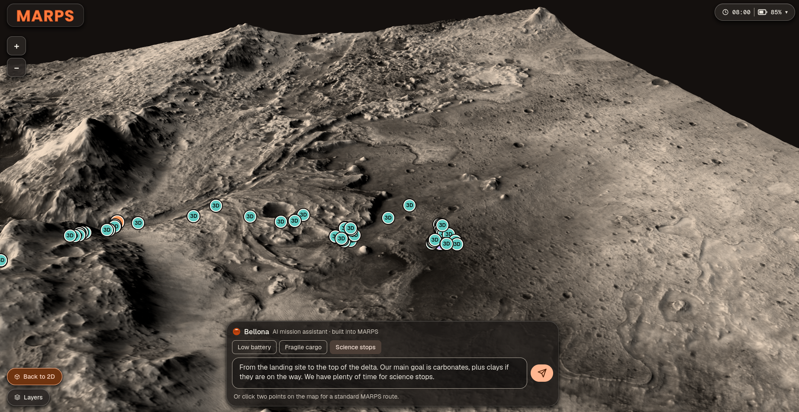](docs/media/screenshots/science-mission-3d.webp)

## Step from the map onto the surface

Select a **3D marker** to open a reconstruction made from Perseverance imagery. Inspect the surroundings on foot in a local scene, or examine a rock detail in an external viewer.

[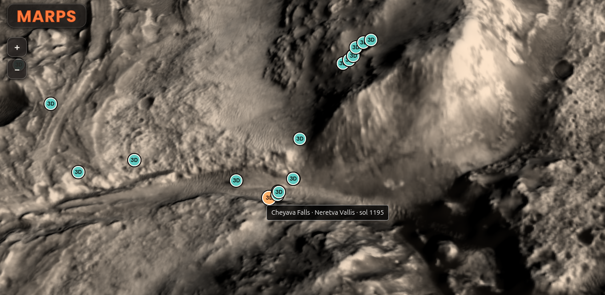](docs/media/surface-exploration.mp4?raw=true)

**[Watch surface exploration · 20 s · MP4](docs/media/surface-exploration.mp4?raw=true)**

| Walk through Cheyava Falls | Inspect Rochette up close |
|---|---|
| [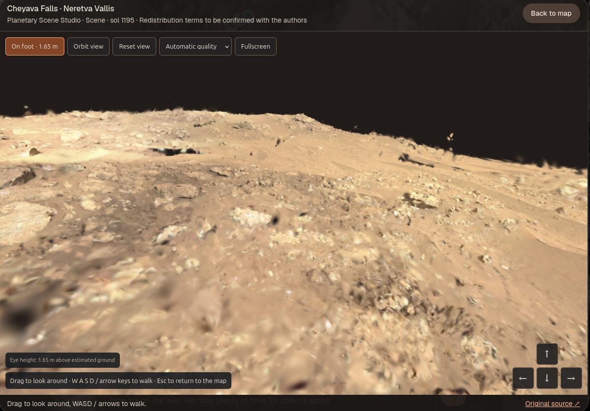](docs/media/screenshots/cheyava-on-foot.webp) | [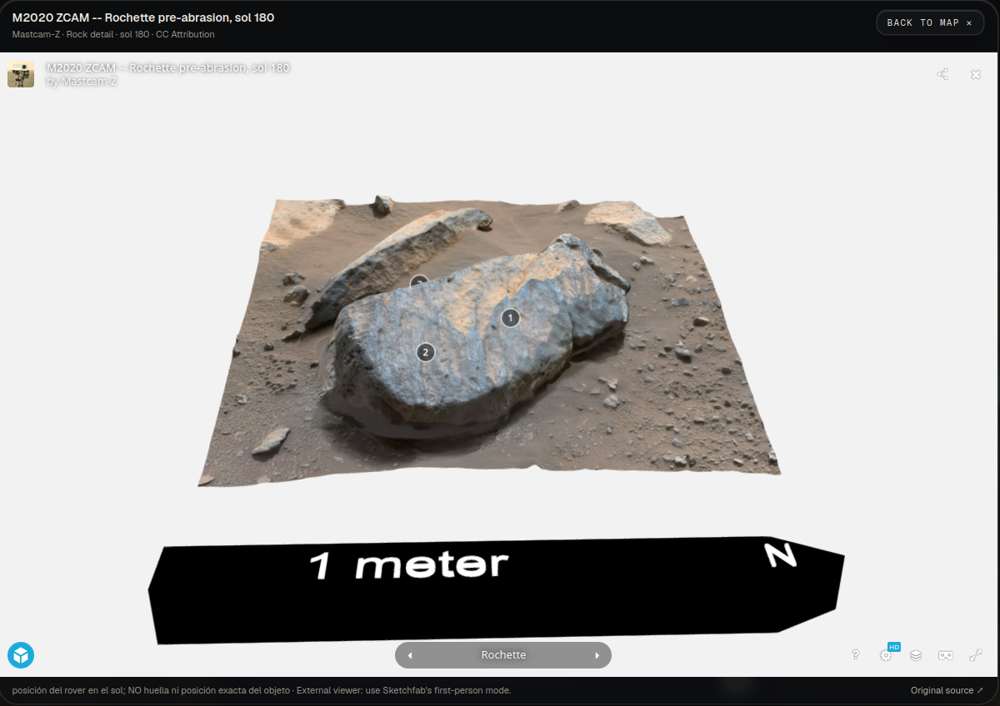](docs/media/screenshots/rochette-rock.webp) |
| Drag to look around; use **WASD / arrow keys** to walk. **Orbit view** and **Reset view** change the viewpoint. | External models keep their source attribution and viewer controls. **Back to map** returns to the mission. |

Reconstructions cover selected sites. Availability and navigation depend on the scene; see [surface reconstruction details and credits](docs/RECONSTRUCTIONS.md) and the [media source list](docs/media/README.md).

## What it does

- **Multi-layer map of Jezero crater** with 14 layers from MRO CTX, Mars Express HRSC, Mars Odyssey THEMIS, CRISM and the USGS geologic map: elevation, slope, roughness, thermal inertia, sunlight, radiation shielding, geology and mineralogy.
- **Mission text → route.** The user describes the excursion ("two astronauts, fragile sample tubes, low battery, look for carbonates"). The SLM extracts crew type, safety level, energy saving, science targets and time budget. The planner turns them into a cost function.
- **Route planning with real constraints:** hard slope and cross-slope limits, sand and dune avoidance, terrain shadows, daylight window, battery reserve, sunlit charging stops and science stops. Every route is compared with a classic shortest-path A*.
- **Bellona briefing.** A second SLM writes one or two sentences justifying the route, using only verified planner figures.
- **3D relief view** (Three.js) with the route drawn over the terrain, any data layer draped on it and clickable **3D reconstructions of the surface** (Perseverance imagery) that can be entered in first person.
- **Editable telemetry** (departure time, battery, capacity, reserve) to explore how the vehicle state changes the route.

The SLM never plans: the route comes from a deterministic planner and its safety limits are always enforced.

## Architecture

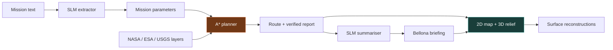

| Directory | Contents |
|---|---|
| [`platform/web`](platform/web) | Web interface (React, Leaflet, Three.js): map, layers, 3D view, mission panel, telemetry |
| [`platform/viewer`](platform/viewer) | Three.js terrain engine and surface-reconstruction viewer used by the interface |
| [`backend`](backend) | FastAPI server that joins interface, planner and SLMs; surface-reconstruction catalogue |
| [`backend/slm`](backend/slm) | The two small language models: Modelfiles, prompts and client |
| [`planner`](planner) | Mission-aware A* route planner and report generator |
| [`data`](data) | Reproducible pipeline that builds the map layers from public NASA/USGS data |
| [`docs`](docs) | Architecture, API contracts, data sources and deployment |

Details: [docs/ARCHITECTURE.md](docs/ARCHITECTURE.md).

## Quick start

Requirements: Python 3.10+, Node.js 20+ and [Ollama](https://ollama.com) (on this machine or on another one reachable over SSH).

```bash
# 1. Python dependencies
python3 -m venv .venv && source .venv/bin/activate
pip install -r backend/requirements.txt -r planner/requirements.txt

# 2. Map data: build the layers once from public sources (see data/jezero/README.md),
#    then the 3D viewer libraries, the surface models and the 3D relief
pip install -r data/jezero/pipeline/requirements.txt
(cd data/jezero/pipeline && python build_layers.py base && python build_layers.py stack && python unpack_stack.py)
python3 backend/prepare_viewer.py
python3 backend/prepare_reconstructions.py
python3 data/jezero/pipeline/build_terrain3d.py --source dtm

# 3. Small language models
ollama pull gemma4:e2b
ollama create jezero-extractor  -f backend/slm/Modelfile
ollama create jezero-summarizer -f backend/slm/Modelfile.summary

# 4. Web interface
(cd platform/web && npm ci && npm run build)

# 5. Run
python3 backend/app.py          # http://127.0.0.1:8765
```

To use Ollama on another machine, run `backend/run.sh` instead (it opens an SSH tunnel; see [backend/slm/README.md](backend/slm/README.md)). For frontend development use `npm run dev` in `platform/web`.

### Try the demo missions

Use the preset chips in Bellona to try three missions with the same origin and destination (Octavia E. Butler Landing → top of the western delta). Each preset supplies its own mission context and vehicle state:

1. **Low battery · charging stop.** An energy-saving route (12.2 km, 10.9 kWh) with a sunlit stop; the system tells the crew when and for how long to recharge.
2. **Crew + fragile cargo.** The safest, gentlest route (14.0 km): strict slope limits and terrain buffers.
3. **Science · carbonates.** A route (14.3 km) that detours through carbonate- and clay-rich terrain, with two science stops.

## Tests

```bash
python -m pytest backend planner data/jezero/pipeline      # Python
cd platform/web && npx tsc -b                               # TypeScript
```

## Documentation

| Document | Topic |
|---|---|
| [docs/media/README.md](docs/media/README.md) | Screenshots, videos, text transcripts and media regeneration |
| [docs/CHALLENGE.md](docs/CHALLENGE.md) | The challenge and how MARPS answers it |
| [docs/CONCEPT.md](docs/CONCEPT.md) | Concept and design principles |
| [docs/ARCHITECTURE.md](docs/ARCHITECTURE.md) | Components, contracts and endpoints |
| [docs/PLANNER.md](docs/PLANNER.md), [docs/PLANNER_INTEGRATION.md](docs/PLANNER_INTEGRATION.md) | Cost model and the `/plan-route` API |
| [backend/slm/README.md](backend/slm/README.md) | The small language models |
| [docs/JEZERO_LAYERS.md](docs/JEZERO_LAYERS.md), [docs/DATA_SOURCES.md](docs/DATA_SOURCES.md) | Map layers and data provenance |
| [docs/TERRAIN_3D.md](docs/TERRAIN_3D.md), [docs/RECONSTRUCTIONS.md](docs/RECONSTRUCTIONS.md) | 3D relief and surface reconstructions |
| [docs/DEPLOY.md](docs/DEPLOY.md) | Deployment (Vercel frontend + local SLM host) |

## Data and credits

All map data comes from public NASA, ESA and USGS products (MRO CTX, Mars Express HRSC, Mars Odyssey THEMIS, MRO CRISM, USGS SIM 3464 geologic map, Mars 2020 imagery). Provenance, licences and processing of every layer are in [docs/DATA_SOURCES.md](docs/DATA_SOURCES.md). Third-party surface reconstructions keep the terms of their authors; external models are embedded, not redistributed.

## Licence

The original code and documentation of MARPS are released under the [Apache License 2.0](LICENSE), the open-source licence the [NASA Space Apps Participant Terms](https://www.spaceappschallenge.org/legal/) apply to submitted solutions by default. Attribution and third-party terms are in [NOTICE](NOTICE).

The licence does not cover third-party material: NASA and USGS data are in the public domain in the United States, other datasets keep their own terms (for example CC BY 4.0) and must be cited, and the language models follow the Gemma model terms. [docs/DATA_SOURCES.md](docs/DATA_SOURCES.md) lists the terms of each dataset. The use of NASA data does not imply endorsement by NASA.
