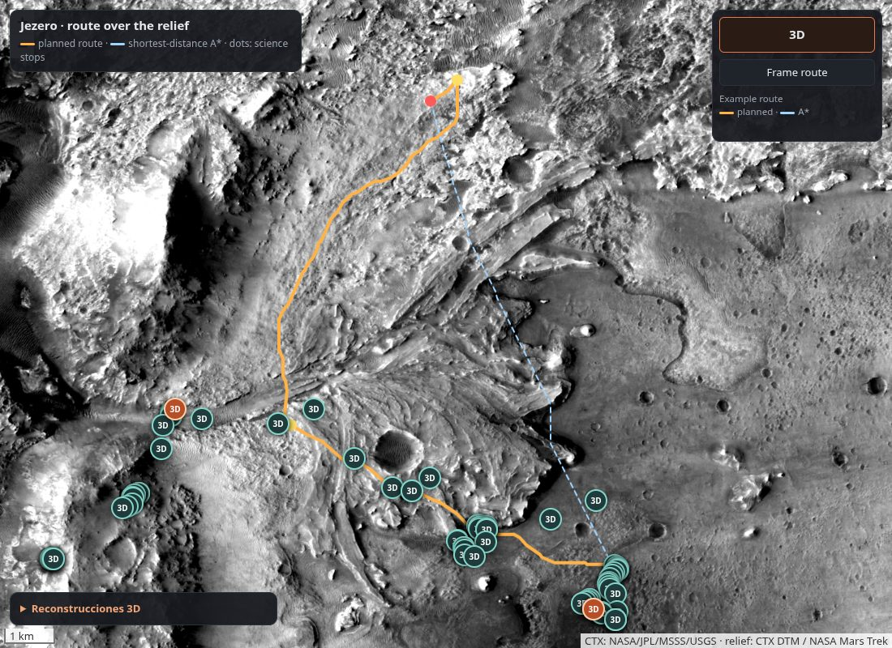
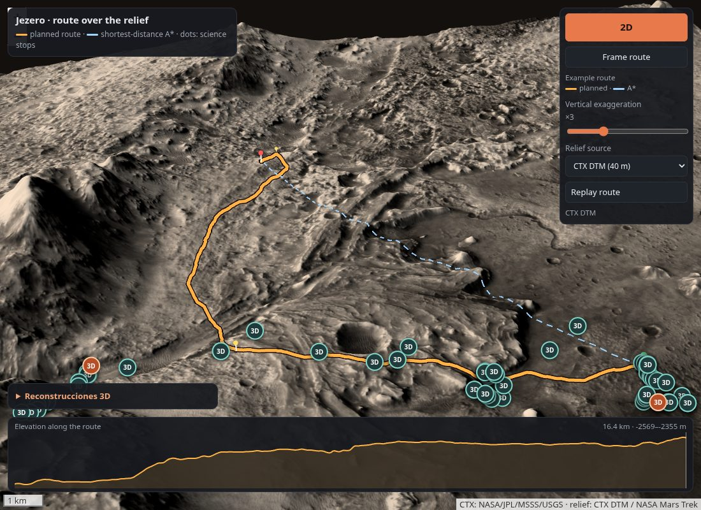

# Surface reconstructions

MARPS lets the user step from the orbital map into 3D reconstructions of the Martian surface built from Perseverance imagery. A catalogue of 244 public reconstructions is placed on the map where a location is known; two of them are stored locally and can be explored in first person.

## Where they appear

| Place | Experience |
|---|---|
| Web application (`platform/web`) | Located scenes are `3D` points in the 2D map and over the 3D relief. A point opens the scene in a modal; closing it returns to the same map, camera and route. |
| Standalone viewer (`/viewer/`, `/viewer/terrain3d/demo.html`) | Layer viewer and full-screen route map with a searchable catalogue and the same surface viewer |
| `/viewer/surface.html?id=…` | Local SPZ/OBJ viewer, normally embedded in the modal |

| Route and reconstruction points in 2D | Tilted CTX DTM with the same route and points |
|---|---|
|  |  |

Orange points are local files, teal points are external scenes and purple points are rock details. The Perseverance traverse is an optional historical context layer in the standalone viewer, not the planned route.

## Preparation

From the repository root:

```bash
python3 backend/prepare_viewer.py            # Three.js, Leaflet and Spark, verified by SHA-256
python3 backend/prepare_reconstructions.py   # the two local models, verified by size and SHA-256
python3 backend/app.py
```

The metadata (catalogue, scene manifests, rover positions) is versioned in `data/jezero/reconstructions`. The heavy files (the 16 MB Gaussian-splat `splat.spz` and the 52 MB NASA Navcam mesh) are downloaded from their original public sources by `prepare_reconstructions.py` and excluded from Git. Use `MARPS_DATASET=/other/path` to read the data from another folder. Without the heavy files, the corresponding catalogue entries are disabled and everything else keeps working.

## Using the viewer

- Select a `3D` point, then **Enter the reconstruction** (standalone viewer) or click it directly (web application).
- In local scenes, drag to look around and use **W A S D / arrow keys** or the movement buttons to walk. Eye height is 1.65 m above a surface estimated from the geometry. **Orbit view** inspects the model, **On foot** and **Reset view** restore the camera, and **Esc** or **Back to map** close the scene.
- Automatic quality keeps the full Gaussians with a GPU and uses a 5 % sample with software rendering. **Full detail** forces the original model; **Light quality** reduces detail for slow machines.
- In the standalone viewer, search by place, author or sol and filter by local files, scenes, details or entries without a location; **Show on map** centres the map (and the tilted camera in 3D).
- The 3D relief view is independent from entering a metre-scale reconstruction. Relief preparation: [TERRAIN_3D.md](TERRAIN_3D.md).

## Data used

| Input (`data/jezero/reconstructions`) | How it is used |
|---|---|
| `catalogos/modelos_curados.csv` | All 242 model records, including author, kind, sol, licence, source and optional rover anchor |
| `cheyava_falls/scene_original.json` + `splat.spz` | Local Cheyava Falls reconstruction: 16.3 MB, 972,047 Gaussians; published site origin provides the map anchor |
| `ejemplo_malla_NASA/*.obj` + matching PNG | Local Navcam sol 180 mesh/texture; kept in its own metre-scale viewer |
| `geografia/PLACES_best_interp.csv` | Corrected site/drive location for the NASA mesh; telemetry and then the public waypoint list are fallbacks |
| `geografia/perseverance_waypoints_mars.geojson` | Optional historical traverse, displayed separately from the planned route |

The data currently yields **244 catalogue entries**, **94 with coordinates**, **150 without a verified map location**, and **2 local models**. Unlocated entries remain searchable but do not acquire invented markers. A missing local binary disables its entry action. A missing dataset reports how to set `--dataset` while keeping the CTX route map available.

The 87,284 PDS inventory fragments, 17 Landform example tilesets and image sets for sites 87/91 are not automatically turned into new independent scenes. The image sets need actual reconstruction work. Existing source descriptions and licensing cautions in the package's `LEEME.md` still apply. See [DATA_SOURCES.md](DATA_SOURCES.md) for the external source record.

## Coordinates and terrain anchoring

Map coordinates are Martian equirectangular metres, sphere radius **3,396,190 m**: `x = R·lon_E·π/180`, `y = R·lat_planetocentric·π/180`. Leaflet uses these metres with `CRS.Simple`; terrestrial Web Mercator is not used.

- Cheyava's published `site_origin_map` gives **77.30519089° E, 18.49748444° N**. Its SPZ is already in local site coordinates, Z up. The viewer rotates −90° around X once; it does not repeat the training shift or fetch missing companion rasters from the original manifest.
- The NASA mesh's map anchor is PLACES best_interp, **site 6 / drive 2684**, **77.444311622° E, 18.430825802° N**. Geometry remains in its own `SITE_FRAME`, X north/Y east/Z down, transformed to Three.js as `(y,−z,−x)` and recentred. Its initial viewpoint uses the observed photographic foreground rather than the centre of an incomplete mesh box.
- In the tilted orbital map, a POI button samples the active relief's bilinear height, follows its vertical exaggeration and is projected through the same camera. A small display lift avoids burying the anchor in the coarse terrain. Outside-relief/off-screen points are hidden; terrain occlusion is approximated with 15 height samples along the sight line. This is a visual marker, not a surveyed outcrop position or a reconstruction footprint.

The local surface model is opened separately from the orbital relief. No claim is made that every vertex of an external reconstruction is georeferenced and overlaid on the global DTM. A rover anchor inferred from a sol may be hundreds of metres from a distant photographed outcrop.

## Components and contracts

| File | Responsibility |
|---|---|
| `backend/reconstructions.py` | Adapts the local catalogue, reads published SPZ origin and corrected NASA RMC location, builds optional traverse |
| `backend/app.py`, `backend/viewer.py` | Server and the map-configuration and terrain-source helpers; `/api/reconstructions`, `/api/traverse`, `/api/terrain-sources` |
| `backend/viewer_dependencies.json` | Versioned library URLs and SHA-256, including the five Three.js line addons |
| `platform/viewer/route-view.mjs` + CSS | Shared trajectory, source selector, tilt/exaggeration/replay controls, physical elevation profile |
| `platform/viewer/terrain3d/terrain3d.mjs` | Terrain rendering, route geometry, coordinate projection, camera focus and pause/resume |
| `platform/viewer/reconstructions.mjs` + CSS | Shared 2D and projected 3D markers, catalogue, optional compact card, modal and iframe lifecycle |
| `platform/viewer/surface.mjs` + HTML/CSS | Local surface navigation and geometry-derived approximate ground |

`initRouteView({map,cfg,container,routeUrl})` returns a route controller. To display an actual newly computed planner response, a caller must pass it to `controller.setRoute(response)` or dispatch `marps:plan-route` with that response as the event's `detail` on the map wrapper. This updates the 2D route, 3D route and profile without rebuilding the reconstruction catalogue. The example label changes to **Ruta planificada / Planned route**. The current UI does not perform the planner HTTP request itself.

`initReconstructions({map,cfg,terrain,container,fitOnLoad:false})` keeps the route's initial framing and returns `{catalog,open,fit,setVisible}`. `mountReconstructionPanel(container)` creates the compact card used by the existing route page; the main page keeps its sidebar.

## Current limits

- Reconstruction coverage is partial, with holes and lower quality away from the original image viewpoints. There is no continuous Street View over the whole crater.
- Surface walking uses a 0.5 m grid estimated from observed geometry and bounded movement with small height steps. It does not provide physical collisions or measurement-grade ground heights.
- Automatic/light SPZ quality can reduce detail. External landscape models request Sketchfab's first-person navigation; rock details and aerial models request orbital navigation. Their scale and embedding availability depend on the author/service. Source links remain available.
- Local assets work offline after preparation. Sketchfab needs internet. Cheyava's redistribution licence is unconfirmed: the file is downloaded by each installation from its original public source and is not redistributed in this repository.
- Orbital POIs may sit behind the controls/profile or a ridge; pan/orbit the map or use the catalogue to centre the desired location. The route and its science stops are independent of reconstruction access points.
- Desktop Chrome with SwiftShader is covered by automated checks. A narrow mobile layout is checked in emulation; touch controls are provided, but real mobile hardware and every external Sketchfab model have not been verified.

## Verification

```bash
python3 backend/prepare_viewer.py --check
python3 -m unittest discover -s backend -p 'test_*.py' -v
python3 -m pytest data/jezero/pipeline/test_build_terrain3d.py -q
node --check platform/viewer/route-view.mjs
node --check platform/viewer/reconstructions.mjs
node --check platform/viewer/terrain3d/terrain3d.mjs
```

With the viewer running and Playwright installed:

```bash
node platform/viewer/test_viewer.cjs
node platform/viewer/test_route_reconstructions.cjs
```

Use `MARPS_VIEWER_URL` for a non-default server, `MARPS_PLAYWRIGHT` for an external Playwright installation and `MARPS_SCREENSHOTS` for captures. The route integration test requires the prepared local dataset and a generated **real relief**. It checks both map pages, nested local scene URLs, route retention, projected marker activation, 3D camera retention, exaggeration without altering profile heights, available DTM/STL switching, marker visibility, return to 2D, missing relief, unavailable WebGL and narrow layouts. Its surface iframe is a lightweight placeholder to avoid allocating two software WebGL scenes at once; the separate viewer test loads the real models. The original viewer test also covers actual local model loading and movement; its external iframe is intercepted so it does not verify Sketchfab availability.
