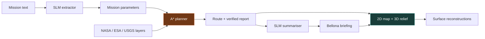

# MARPS technical overview

This document holds the technical material that used to live in the main README. The [README](../README.md) presents the product; here are the capabilities in detail, the architecture, how to run MARPS locally and where the rest of the documentation lives.

## What it does

- **Multi-layer map of Jezero crater** with 14 layers from MRO CTX, Mars Express HRSC, Mars Odyssey THEMIS, CRISM and the USGS geologic map: elevation, slope, roughness, thermal inertia, sunlight, radiation shielding, geology and mineralogy.
- **Mission text → route.** The user describes the excursion ("two astronauts, fragile sample tubes, low battery, look for carbonates"). The SLM extracts crew type, safety level, energy saving, science targets and time budget. The planner turns them into a cost function.
- **Route planning with real constraints:** hard slope and cross-slope limits, sand and dune avoidance, terrain shadows, daylight window, battery reserve, sunlit charging stops and science stops. Every route is compared with a classic shortest-path A*.
- **Bellona briefing.** A second SLM writes one or two sentences justifying the route, using only verified planner figures.
- **3D relief view** (Three.js) with the route drawn over the terrain, any data layer draped on it and clickable **3D reconstructions of the surface** (Perseverance imagery) that can be entered in first person.
- **Editable telemetry** (departure time, battery, capacity, reserve) to explore how the vehicle state changes the route.

The SLM never plans: the route comes from a deterministic planner and its safety limits are always enforced.

## Architecture



| Directory | Contents |
|---|---|
| [`platform/web`](../platform/web) | Web interface (React, Leaflet, Three.js): map, layers, 3D view, mission panel, telemetry |
| [`platform/viewer`](../platform/viewer) | Three.js terrain engine and surface-reconstruction viewer used by the interface |
| [`backend`](../backend) | FastAPI server that joins interface, planner and SLMs; surface-reconstruction catalogue |
| [`backend/slm`](../backend/slm) | The two small language models: Modelfiles, prompts and client |
| [`planner`](../planner) | Mission-aware A* route planner and report generator |
| [`data`](../data) | Reproducible pipeline that builds the map layers from public NASA/USGS data |
| [`docs`](.) | Architecture, API contracts, data sources and deployment |

Details: [docs/ARCHITECTURE.md](ARCHITECTURE.md).

## Quick start

Requirements: Python 3.10+, Node.js 20+ and [Ollama](https://ollama.com) (on this machine or on another one reachable over SSH).

```bash
# 1. Python dependencies
python3 -m venv .venv && source .venv/bin/activate
pip install -r backend/requirements.txt -r planner/requirements.txt

# 2. Map data: build the layers once from public sources (see data/jezero/README.md),
#    then the 3D viewer libraries, the surface models and the 3D relief
pip install -r data/jezero/pipeline/requirements.txt
(cd data/jezero/pipeline && python build_layers.py base && python build_layers.py stack && python unpack_stack.py)
python3 backend/prepare_viewer.py
python3 backend/prepare_reconstructions.py
python3 data/jezero/pipeline/build_terrain3d.py --source dtm

# 3. Small language models
ollama pull gemma4:e2b
ollama create jezero-extractor  -f backend/slm/Modelfile
ollama create jezero-summarizer -f backend/slm/Modelfile.summary

# 4. Web interface
(cd platform/web && npm ci && npm run build)

# 5. Run
python3 backend/app.py          # http://127.0.0.1:8765
```

To use Ollama on another machine, run `backend/run.sh` instead (it opens an SSH tunnel; see [backend/slm/README.md](../backend/slm/README.md)). For frontend development use `npm run dev` in `platform/web`.

### Try the demo missions

Use the preset chips in Bellona to try three missions with the same origin and destination (Octavia E. Butler Landing → top of the western delta). Each preset supplies its own mission context and vehicle state:

1. **Low battery · charging stop.** An energy-saving route (12.2 km, 10.9 kWh) with a sunlit stop; the system tells the crew when and for how long to recharge.
2. **Crew + fragile cargo.** The safest, gentlest route (14.0 km): strict slope limits and terrain buffers.
3. **Science · carbonates.** A route (14.3 km) that detours through carbonate- and clay-rich terrain, with two science stops.

## Tests

```bash
python -m pytest backend planner data/jezero/pipeline      # Python
cd platform/web && npx tsc -b                               # TypeScript
```

## Documentation

| Document | Topic |
|---|---|
| [docs/media/README.md](media/README.md) | Screenshots, videos, text transcripts and media regeneration |
| [docs/CHALLENGE.md](CHALLENGE.md) | The challenge and how MARPS answers it |
| [docs/CONCEPT.md](CONCEPT.md) | Concept and design principles |
| [docs/ARCHITECTURE.md](ARCHITECTURE.md) | Components, contracts and endpoints |
| [docs/PLANNER.md](PLANNER.md), [docs/PLANNER_INTEGRATION.md](PLANNER_INTEGRATION.md) | Cost model and the `/plan-route` API |
| [backend/slm/README.md](../backend/slm/README.md) | The small language models |
| [docs/JEZERO_LAYERS.md](JEZERO_LAYERS.md), [docs/DATA_SOURCES.md](DATA_SOURCES.md) | Map layers and data provenance |
| [docs/TERRAIN_3D.md](TERRAIN_3D.md), [docs/RECONSTRUCTIONS.md](RECONSTRUCTIONS.md) | 3D relief and surface reconstructions |
| [docs/DEPLOY.md](DEPLOY.md) | Deployment (Vercel frontend + local SLM host) |
