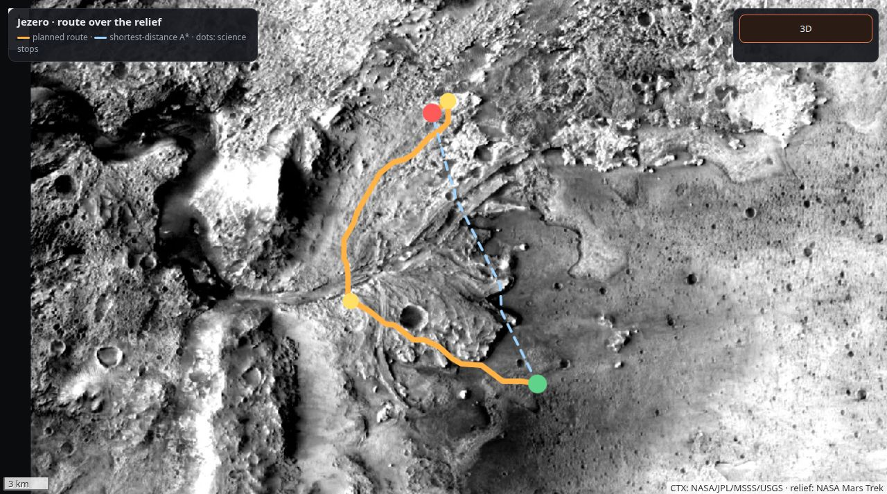
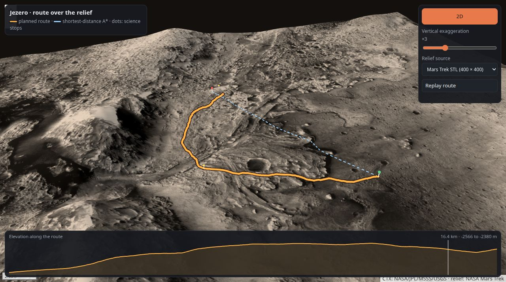

# 3D view: the route over the relief

The **3D** button tilts the map as Google Maps does, raises the relief with vertical exaggeration and draws the planner's route on top of it, with an elevation profile that moves along the route. **2D** returns to a top-down view centred where the user left the camera.

Status: **integrated in both the main map and the existing route view**. Both use the same saved `POST /plan-route` example, relief controls and surface-reconstruction points. Closing a reconstruction restores the active tilted map and its camera. The browser does not yet request new missions from the planner automatically. See [RECONSTRUCTIONS.md](RECONSTRUCTIONS.md).

| 2D | 3D with the Mars Trek relief, route being drawn | 3D with the CTX DTM |
|---|---|---|
|  |  |  |

## Files

```
data/jezero/pipeline/build_terrain3d.py       STL or DTM -> heightmap + metadata + texture
data/jezero/pipeline/test_build_terrain3d.py  pytest tests
platform/viewer/terrain3d/terrain3d.mjs       reusable module (class Terrain3D), no viewer dependencies
platform/viewer/route-view.mjs               shared route, tilt/source controls and elevation profile
platform/viewer/route-view.css               floating controls, retaining the route map's style
platform/viewer/reconstructions.mjs          2D/projected 3D points + catalogue + surface modal
platform/viewer/terrain3d/demo.html           full-screen route view, now with reconstruction access
platform/viewer/terrain3d/demo_route.json     real /plan-route response (planner/examples/plan_route_request.json)
platform/viewer/data/terrain3d/               generated by the converter (ignored by Git)
```

## Prepare the real relief and open either map

Requires WebGL. Use Chrome or Firefox (the built-in browser of some tools has no WebGL).

```bash
# Data is not in Git. If the team's processed DTM and raw orthoimage are already installed:
python3 data/jezero/pipeline/build_terrain3d.py --source dtm

# Download/verify web libraries, including the five Three.js line addons.
python3 backend/prepare_viewer.py
python3 backend/viewer.py
```

Open http://127.0.0.1:8765 (main map) or http://127.0.0.1:8765/terrain3d/demo.html (the existing floating-card route map). Both use the locally prepared Three.js 0.178.0 and line addons through an import map; no CDN connection is needed at runtime. Restart an older viewer server after updating the code.

In 3D: drag to orbit, scroll to zoom, right-drag to pan. The slider sets vertical exaggeration (×1 to ×8), the selector lists only complete generated reliefs (DTM first), and **Replay route** draws the route again. Circular **3D** reconstruction points are clickable above the terrain. **Frame route** and the reconstruction catalogue's location actions work in either map mode.

The converter needs `numpy`, `rasterio` and `pillow`, all listed in `data/jezero/pipeline/requirements.txt`.

### Fresh checkout with the CTX orthoimage already in `assets/`

This preparation does not require the full multi-layer stack. The official DTM download is **9,662,387 bytes**, a 1596 × 1512 grid at 20 m. The converter resamples it to approximately 40 m for the browser. Use a virtual environment for the Python conversion dependencies:

```bash
python3 -m venv .venv
. .venv/bin/activate
pip install numpy rasterio pillow
mkdir -p data/jezero/raw
curl -fL 'https://planetarymaps.usgs.gov/mosaic/mars2020_trn/CTX/JEZ_ctx_B_soc_008_DTM_MOLAtopography_DeltaGeoid_20m_Eqc_latTs0_lon0.tif' \
  -o data/jezero/raw/JEZ_ctx_B_soc_008_DTM_MOLAtopography_DeltaGeoid_20m_Eqc_latTs0_lon0.tif
python3 data/jezero/pipeline/build_terrain3d.py --source dtm \
  --dtm data/jezero/raw/JEZ_ctx_B_soc_008_DTM_MOLAtopography_DeltaGeoid_20m_Eqc_latTs0_lon0.tif \
  --ortho assets/JEZ_ctx_B_soc_008_orthoMosaic_6m_Eqc_latTs0_lon0.tif
```

The DTM SHA-256 and access date are recorded in [DATA_SOURCES.md](DATA_SOURCES.md). Both the downloaded source and the generated JSON/F32/texture files remain ignored by Git. No substitute elevations are generated if the input is missing. Without complete generated reliefs, the map disables its tilt button and keeps the 2D trajectory and surface reconstructions available.

### STL supplied at the repository root

The supplied `trekSTL.stl` can stay at the root. Generate the second relief using the same real DTM and orthoimage as references:

```bash
python3 data/jezero/pipeline/build_terrain3d.py --source stl --stl trekSTL.stl \
  --dtm data/jezero/raw/JEZ_ctx_B_soc_008_DTM_MOLAtopography_DeltaGeoid_20m_Eqc_latTs0_lon0.tif \
  --ortho assets/JEZ_ctx_B_soc_008_orthoMosaic_6m_Eqc_latTs0_lon0.tif
```

Reload either map to discover the newly generated **Mars Trek STL** source. The converter's original defaults still accept an STL at `data/jezero/raw/trekSTL.stl`, a DTM at `data/jezero/layers20m/elev_ctx.tif` and the orthoimage in `data/jezero/raw/`. The new `--dtm` and `--ortho` arguments let existing files be reused without copying them. The root STL is also excluded from Git.

## The Mars Trek STL

The supplied `trekSTL.stl` is a binary STL of **323,190 triangles** and a **400 × 400 XY grid**, with indices 0–399 and a relative Z range of **−261.93 to 0**. It is the local Mars Trek export supplied by the user, without embedded georeference or physical units. Its layer/export settings have not been independently recorded. At 16,159,584 bytes it is converted into a smaller heightmap in metres before browser use:

1. **Read:** rebuilds the grid Z[y, x] from the vertices.
2. **Georeference:** tests the 8 possible orientations (rotations and mirrors) against the CTX DTM (`layers20m/elev_ctx.tif`), then adjusts the four edges of the window covering the STL to maximise the correlation. Result: **horizontal mirror**, **r = 0.978**, and the STL footprint is slightly larger than our bbox (about 1.9 km to the west and 0.7 km to the north).
3. **Vertical scale:** for this supplied file, regression against the official CTX DTM gives **8.6801 m per STL unit**, offset **−422.49 m**, **RMSE 55.31 m**. This differs from the scaling of the earlier export described in the progress log: the fit is file-specific and is recomputed, not hardcoded.
4. **Crop** to cells with centres inside the bbox: **374 × 381** cells at about 85 m spacing, in real metres. Edge-cell footprints can extend slightly beyond the target box.
5. **Texture:** the 6 m CTX orthomosaic cropped to the same bounds (4096 px wide, JPEG).

The whole fit is recorded in `terrain_stl.json` (`fit`, `fit_window_px`, `crop_window_px`), so the result can be reproduced. `--source dtm` produces the same format directly from the DTM.

**Which relief to use.** Both produce the same format. The STL is smaller and shows the fitted Mars Trek relief; the CTX DTM is sharper (about 40 m) and comes from the same elevation source as the planner. The DTM is the default; the STL is an alternative and a visual check.

The source planner grid is 20 m while the browser DTM is resampled to about 40 m: profile heights use the loaded relief, and are **not guaranteed to reproduce the planner's ascent metric exactly**. Changing vertical exaggeration does not change those physical heights.

## Data format

`<name>.json`:
```json
{
 "width": 374, "height": 381,
 "bounds": {"left": 4573640.950853, "top": 1109660.340188, "right": 4605561.850853, "bottom": 1079485.140188},
 "radius": 3396190.0, "units": "m", "min": -2696.09, "max": -1590.59,
 "heights": "terrain_stl.f32", "texture": "terrain_stl_ctx.jpg", "source": "stl", "fit": {…}
}
```
- `bounds`: equirectangular Mars metres (`x = R·lon·π/180`, `y = R·lat·π/180`, R = 3 396 190 m), the same system as `platform/viewer/data/config.json` and the planner's GeoTIFFs.
- `<name>.f32`: `width × height` float32, little-endian, heights in metres. Row 0 = north, column 0 = west. The grid covers exactly `bounds`.
- `texture`: an image that covers exactly `bounds`. Textures for other layers (slope, CRISM…) can be generated with the same bounds.

## Module API (`terrain3d.mjs`)

```js
import { Terrain3D, leafletView } from "./terrain3d/terrain3d.mjs";

const t3d = new Terrain3D(mapContainer, { exaggeration: 3, pitch: 58, bearing: -25 });
await t3d.load("data/terrain3d/terrain_dtm.json");  // can be called again to switch relief
t3d.setRoute(planRouteResponse);                   // {geojson} | FeatureCollection | [[lon, lat], …]

await t3d.enter(leafletView(map, toXY));           // animates 2D -> 3D and draws the route
const view = await t3d.exit();                     // animates 3D -> 2D; returns {x, y, height} in metres
```

| Member | What it does |
|---|---|
| `new Terrain3D(container, opts)` | `container` needs `position: relative`. The canvas is layered at `z-index: 900`, above Leaflet panes and below floating panels that use ≥ 1000 |
| `opts` | `exaggeration` (3), `pitch` (58°), `bearing` (−25°), `fov` (35°), `enterMs` (1800), `exitMs` (1200), `routeMs` (3000), `lift` (12 m), `colors` |
| `load(url)` | Loads the JSON, the `.f32` and the texture. Returns the metadata, or `null` if another `load` was requested meanwhile (the last request wins) |
| `setRoute(x)` | Draws `route` (solid line with halo), `classic_astar` (dashed), and pins for `origin`, `destination`, `science_stop`, `charging_stop`. Can be called before or after `load` |
| `enter(view)` | `view = {x, y, height}`: centre and visible height (m) of the 2D map. The animation starts with the same framing, so the switch is seamless |
| `exit()` | Returns to top-down with north up, fades out and returns the final framing |
| `replayRoute()` | Draws the route again |
| `setExaggeration(v)` | Changes the exaggeration live |
| `heightAt(lon, lat)`, `heightAtXY(x, y)` | Bilinear height of the loaded relief |
| `projectPoint([lon,lat])` | Screen `{x,y}` for a reconstruction anchor; `null` outside the relief/frustum or behind approximately sampled terrain |
| `focusAtXY(x,y,visibleHeight)` | Centres the active tilted camera on a route or catalogue location |
| `setPaused(bool)` | Suspends/resumes rendering and animation time while a surface reconstruction modal is open |
| `routeProfile()` | `[{d, h}]`: cumulative distance and height, for the elevation chart |
| `on(fn)` | Events `fn(type, data)`: `"enter"`, `"entered"`, `"exit"` (with `view`), `"route"` (fraction 0–1 drawn), `"frame"` (projection refresh). Returns an unsubscribe function |
| `dispose()` | Frees GPU resources, listeners and the canvas |

`leafletView(map, toXY)` reads the framing of a Leaflet map. `toXY(latlng)` must return `[x, y]` in equirectangular metres:
- **This viewer** (`CRS.Simple` in metres): `latlng => [latlng.lng, latlng.lat]`.
- **A map in CTX pixels** (`L.CRS.Simple` with 6 m pixels, `lat = −row`, `lng = col`): `latlng => [left + latlng.lng * 6, top + latlng.lat * 6]`, where `left` and `top` are the corner values from `config.json`.

The planner's response is used as it is. The module reads the `route`, `classic_astar`, `origin`, `destination`, `science_stop` and `charging_stop` features.

## Integration in the map

1. `route-view.mjs` is shared by `index.html` and `terrain3d/demo.html`, preserving the existing route colours, floating controls and profile. It loads the saved example route and frames it before loading reconstruction access points.
2. `/api/terrain-sources` advertises only complete generated DTM/STL bundles. It prefers DTM. Relief heights and texture load on the first 3D press, not at map startup. Missing relief or failed WebGL leaves the 2D route usable.
3. `backend/prepare_viewer.py` installs the five line addons with versioned SHA-256 checks; both maps use the local import map. The previous CDN-only demo setup is no longer needed.
4. The route controller exposes `setRoute(planRouteResponse)` and listens for `marps:plan-route` on its wrapper. A future HTTP planner caller can use that hook; the current UI does not send mission requests by itself.
5. `reconstructions.mjs` draws the same catalogue anchors as Leaflet markers and projected HTML buttons on the relief. Opening a local/external reconstruction pauses the terrain loop and clock. Closing its iframe resumes the same tilted camera, route and exaggeration. Catalogue actions centre either map mode.

## Limitations

- Needs WebGL for the tilted relief. Failure is caught by the route controls; the 2D trajectory and catalogue keep working.
- The 3D view uses a perspective camera (FOV 35°) and Leaflet is orthographic. The framing matches at the centre; the edges differ slightly, which the fade hides.
- The 3D texture is always the CTX orthomosaic, even when another layer is active in 2D.
- The STL gives relief at about 85 m per cell and its georeference is a fit (r = 0.978, RMSE 55 m). Features smaller than about 200 m are not visible. Use the DTM for measurements.
- `enter()` and `exit()` can interrupt each other: each call invalidates the previous animation.
- Checked in headless Chrome with SwiftShader. Automated map integration checks live in `platform/viewer/test_route_reconstructions.cjs`; local surface render/movement checks are in `test_viewer.cjs`. Integration tests use a lightweight modal placeholder, while the separate surface test loads the real SPZ/OBJ. Real mobile hardware has not been verified; touch controls come from `OrbitControls`.
- The route in `demo_route.json` is a single example (origin to destination in `planner/examples/`).
