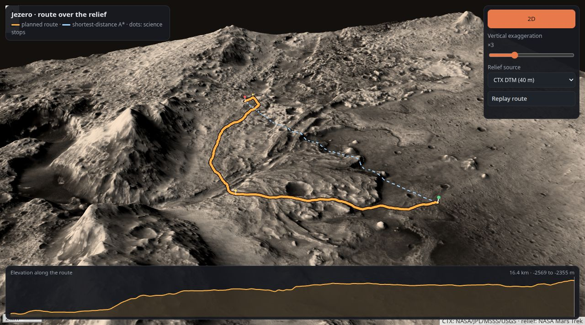

# 3D view: the route over the relief

The **3D** button tilts the map as Google Maps does, raises the relief with vertical exaggeration and draws the planner's route on top of it, with an elevation profile that moves along the route. **2D** returns to a top-down view centred where the user left the camera.

Status: **working demo**, not yet wired into the main map. It uses a real route returned by `POST /plan-route` and stored as a file.

| 2D | 3D with the Mars Trek relief, route being drawn | 3D with the CTX DTM |
|---|---|---|
|  |  |  |

## Files

```
data/jezero/pipeline/build_terrain3d.py       STL or DTM -> heightmap + metadata + texture
data/jezero/pipeline/test_build_terrain3d.py  pytest tests
platform/viewer/terrain3d/terrain3d.mjs       reusable module (class Terrain3D), no viewer dependencies
platform/viewer/terrain3d/demo.html           demo: Leaflet + 3D button + elevation profile
platform/viewer/terrain3d/demo_route.json     real /plan-route response (planner/examples/plan_route_request.json)
platform/viewer/data/terrain3d/               generated by the converter (ignored by Git)
```

## Run the demo

Requires WebGL. Use Chrome or Firefox (the built-in browser of some tools has no WebGL).

```bash
# 1. Data (not in Git). Place the Mars Trek STL at data/jezero/raw/trekSTL.stl
python3 data/jezero/pipeline/build_terrain3d.py               # relief from the STL
python3 data/jezero/pipeline/build_terrain3d.py --source dtm  # relief from the CTX DTM

# 2. Server (serves platform/viewer, including the demo)
python3 backend/viewer.py
```

Open http://127.0.0.1:8765/terrain3d/demo.html. The demo loads Three.js 0.178.0 from jsDelivr through an import map.

In 3D: drag to orbit, scroll to zoom, right-drag to pan. The slider sets the vertical exaggeration (×1 to ×8), the selector switches between the two reliefs, and **Replay route** draws the route again.

The converter needs `numpy`, `rasterio` and `pillow`, all listed in `data/jezero/pipeline/requirements.txt`.

## The Mars Trek STL

`trekSTL.stl` is an export from JPL Mars Trek: a binary STL of 323,190 triangles forming a **400 × 400 vertex grid**, with X/Y as indices (0–399) and a relative Z (−50 to 0). **It has no georeference and no units**, and at 16 MB it is too heavy for the web. The converter therefore turns it into a heightmap in metres:

1. **Read:** rebuilds the grid Z[y, x] from the vertices.
2. **Georeference:** tests the 8 possible orientations (rotations and mirrors) against the CTX DTM (`layers20m/elev_ctx.tif`), then adjusts the four edges of the window covering the STL to maximise the correlation. Result: **horizontal mirror**, **r = 0.978**, and the STL footprint is slightly larger than our bbox (about 1.9 km to the west and 0.7 km to the north).
3. **Vertical scale:** linear regression of Z against the DTM: **29.04 m per unit**, offset −1239 m, **RMSE 55 m**. At about 85 m per cell the error is dominated by crater rims and delta walls.
4. **Crop** to the part inside the bbox: 374 × 382 cells, in real metres.
5. **Texture:** the 6 m CTX orthomosaic cropped to the same bounds (4096 px wide, JPEG).

The whole fit is recorded in `terrain_stl.json` (`fit`, `fit_window_px`, `crop_window_px`), so the result can be reproduced. `--source dtm` produces the same format directly from the DTM.

**Which relief to use.** Both produce the same format and the viewer does not care which one it gets. The STL is smaller and shows the Mars Trek relief; the CTX DTM is sharper (40 m) and is exactly the grid the planner uses, so the heights shown match `report.route.ascent_m`. The DTM is the better default for the product; the STL is useful as an alternative and as a check.

## Data format

`<name>.json`:
```json
{
 "width": 374, "height": 382,
 "bounds": {"left": 4573625.35, "top": 1109662.14, "right": 4605621.05, "bottom": 1079484.14},
 "radius": 3396190.0, "units": "m", "min": -2696.1, "max": -1592.2,
 "heights": "terrain_stl.f32", "texture": "terrain_stl_ctx.jpg", "source": "stl", "fit": {…}
}
```
- `bounds`: equirectangular Mars metres (`x = R·lon·π/180`, `y = R·lat·π/180`, R = 3 396 190 m), the same system as `platform/viewer/data/config.json` and the planner's GeoTIFFs.
- `<name>.f32`: `width × height` float32, little-endian, heights in metres. Row 0 = north, column 0 = west. The grid covers exactly `bounds`.
- `texture`: an image that covers exactly `bounds`. Textures for other layers (slope, CRISM…) can be generated with the same bounds.

## Module API (`terrain3d.mjs`)

```js
import { Terrain3D, leafletView } from "./terrain3d/terrain3d.mjs";

const t3d = new Terrain3D(mapContainer, { exaggeration: 3, pitch: 58, bearing: -25 });
await t3d.load("data/terrain3d/terrain_dtm.json");  // can be called again to switch relief
t3d.setRoute(planRouteResponse);                   // {geojson} | FeatureCollection | [[lon, lat], …]

await t3d.enter(leafletView(map, toXY));           // animates 2D -> 3D and draws the route
const view = await t3d.exit();                     // animates 3D -> 2D; returns {x, y, height} in metres
```

| Member | What it does |
|---|---|
| `new Terrain3D(container, opts)` | `container` needs `position: relative`. The canvas is layered at `z-index: 900`, above Leaflet panes and below floating panels that use ≥ 1000 |
| `opts` | `exaggeration` (3), `pitch` (58°), `bearing` (−25°), `fov` (35°), `enterMs` (1800), `exitMs` (1200), `routeMs` (3000), `lift` (12 m), `colors` |
| `load(url)` | Loads the JSON, the `.f32` and the texture. Returns the metadata, or `null` if another `load` was requested meanwhile (the last request wins) |
| `setRoute(x)` | Draws `route` (solid line with halo), `classic_astar` (dashed), and pins for `origin`, `destination`, `science_stop`, `charging_stop`. Can be called before or after `load` |
| `enter(view)` | `view = {x, y, height}`: centre and visible height (m) of the 2D map. The animation starts with the same framing, so the switch is seamless |
| `exit()` | Returns to top-down with north up, fades out and returns the final framing |
| `replayRoute()` | Draws the route again |
| `setExaggeration(v)` | Changes the exaggeration live |
| `heightAt(lon, lat)`, `heightAtXY(x, y)` | Bilinear height of the loaded relief |
| `routeProfile()` | `[{d, h}]`: cumulative distance and height, for the elevation chart |
| `on(fn)` | Events `fn(type, data)`: `"enter"`, `"entered"` (tilt finished; a good moment to re-enable the button), `"exit"` (with `view`), `"route"` (fraction 0–1 drawn). Returns an unsubscribe function |
| `dispose()` | Frees GPU resources, listeners and the canvas |

`leafletView(map, toXY)` reads the framing of a Leaflet map. `toXY(latlng)` must return `[x, y]` in equirectangular metres:
- **This viewer** (`CRS.Simple` in metres): `latlng => [latlng.lng, latlng.lat]`.
- **A map in CTX pixels** (`L.CRS.Simple` with 6 m pixels, `lat = −row`, `lng = col`): `latlng => [left + latlng.lng * 6, top + latlng.lat * 6]`, where `left` and `top` are the corner values from `config.json`.

The planner's response is used as it is. The module reads the `route`, `classic_astar`, `origin`, `destination`, `science_stop` and `charging_stop` features.

## Integrating it in the main map

1. **Data:** run the converter, which writes to `platform/viewer/data/terrain3d/` (served by `backend/viewer.py` at `/data/terrain3d/`).
2. **Three.js:** the demo loads Three.js from jsDelivr. The production viewer already vendors Three 0.178.0 in `platform/viewer/vendor/` (see `backend/viewer_dependencies.json`), so an import map should point `three` and `three/addons/` there. **Pending:** the module also needs the line-geometry addons (`lines/Line2.js`, `lines/LineGeometry.js`, `lines/LineMaterial.js`, `lines/LineSegments2.js`, `lines/LineSegmentsGeometry.js`). Add them to `viewer_dependencies.json` with their SHA-256, as is done for `OrbitControls`.
3. **Button:** the handler in `demo.html` is about 25 lines: `enter(leafletView(...))` on the first press and `exit()` plus `map.setView(...)` on the second. Load the relief on the first press to avoid downloading about 5 MB at start-up.
4. **Route:** after each `POST /plan-route`, call `t3d.setRoute(response)`. If the 3D view is open the route appears at once; otherwise it is drawn when the view is entered.
5. **Profile (optional):** `routeProfile()` and the `"route"` event feed a chart. `demo.html` has a 20-line SVG version.

## Limitations

- Needs WebGL. Without it `load()` throws; the demo then shows "3D unavailable" and the 2D map keeps working.
- The 3D view uses a perspective camera (FOV 35°) and Leaflet is orthographic. The framing matches at the centre; the edges differ slightly, which the fade hides.
- The 3D texture is always the CTX orthomosaic, even when another layer is active in 2D.
- The STL gives relief at about 85 m per cell and its georeference is a fit (r = 0.978, RMSE 55 m). Features smaller than about 200 m are not visible. Use the DTM for measurements.
- `enter()` and `exit()` can interrupt each other: each call invalidates the previous animation.
- Checked in headless Chrome with SwiftShader: entering, drawing the route, switching relief and exiting. Not tested on real mobile hardware; touch controls come from `OrbitControls`.
- The route in `demo_route.json` is a single example (origin to destination in `planner/examples/`).
